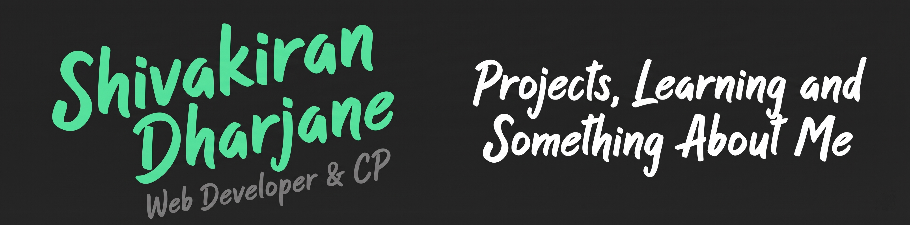

  

# Hello, folks! 👋

My name is **Shivakiran Dharjane**, an Information Technology student at **Walchand College of Engineering, Sangli**. I enjoy building for the web and practicing competitive programming. You can find me on [LinkedIn](https://www.linkedin.com/in/YOUR-USERNAME) or [Instagram](https://instagram.com/YOUR-USERNAME).

## 🔧 Technologies & Tools

## 📚 Open-Source & Learning Focus

- Exploring open source and learning to contribute to backend projects and automation workflows.
- Currently improving DSA and system design fundamentals for SDE roles.
- Exploring scalable backend architecture and cloud-native development patterns.

## 📫 Let's Connect

